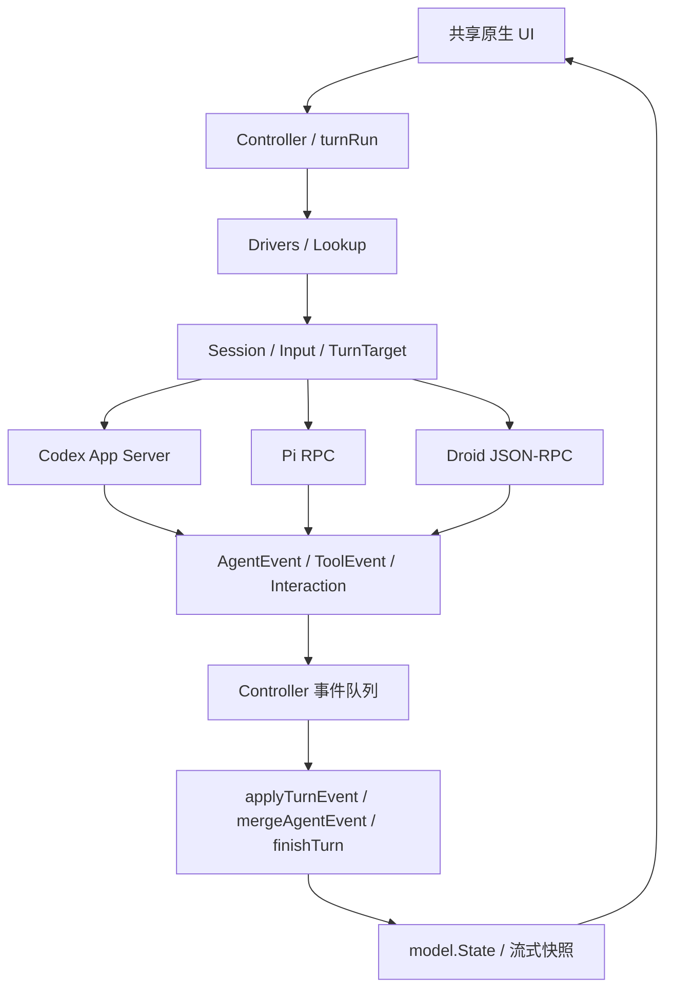

# Harness 驱动架构

[开发指南](development.md) · [接入与维护 Skill](../.agents/skills/harness-maintenance/SKILL.md)

MujicAgent 把会话的产品行为放在共享 Controller 中，把 CLI 的协议翻译放在驱动中。Codex、Pi、Droid 使用同一套发送、队列确认、停止入口、结束处理、事件归并和持久化流程。

## 边界



| 层 | 入口 | 责任 |
| --- | --- | --- |
| 驱动目录 | `internal/harness/drivers.go` | 稳定 ID、名称、协议能力、启动参数、执行和控制回调、原生会话标识 |
| 会话契约 | `internal/harness/session.go`、`agents.go` | 有序输入、运行实例、接受与结束事件、Steer、停止、取消 |
| Codex 协议 | `internal/harness/codex_session.go`、`internal/codex/` | 权限校验、thread/start/resume、turn/start、通知解析、原生控制与连接 |
| Pi 协议 | `internal/harness/pi.go`、`pi_events.go` | prompt/steer、扩展交互、工具与消息事件、agent_settled |
| Droid 协议 | `internal/harness/droid.go`、`droid_interaction.go` | initialize/load/settings、双向请求、通知、历史过滤、Script 子调用 |
| 进程与输入 | `internal/harness/rpc_process.go`、`input.go` | Pi/Droid 运行及模型探测共用的管道、扫描器、进程树取消与回收、图片编码 |
| 产品生命周期 | `internal/controller/turns.go`、`queue.go` | 一次运行的归属、确认、排队、收尾、失败与停止策略 |
| 事件归并 | `internal/controller/agent_events.go` | 所有驱动共用的稳定 Item、增量/快照、工具详情脱敏、压缩状态 |
| 独立管理能力 | `internal/harness/models.go`、`installers.go` | 官方模型目录、安装来源与更新适配，不与发送消息绑定 |

`Drivers` 同时是展示与执行注册目录，不再另外维护只含 Pi/Droid 的运行注册表。注册项缺少运行适配器会拒绝启动，缺少 Steer 适配器不会启用 Steer。旧持久化记录的空 Harness ID 仍由 `Thread.Driver()` 解释为 Codex。

## 一次运行的生命周期

`sendThread` 为三种驱动统一准备工作目录、模型与权限快照，先保存本地回合，再在后台转换附件、导出标注图片并启动 `Session.Run`。保存失败会恢复本地状态，不启动 CLI；附件准备期间也能取消。运行实例由 `turnRun` 持有，后台回调必须仍属于这个实例才能修改状态。流式内容、输入确认和最终状态复用后台快照保存，避免在 UI 线程编码整个历史。

接受和结束是两件独立的事：

1. 创建或恢复原生会话只更新 `Session`，工具输出只更新 Item。它们都不能消费队列消息或标记交接上下文已发送。
2. `Accepted` 表示 CLI 已明确接受本次输入。此时才移除对应队列消息并设置 `HandoffSent`。
3. `End` 统一交给 `finishTurn`。成功只在接受已确认后继续队列；失败或停止保留未被接受的消息，并清除发送标记。待答请求和未结束工具也在这里收尾。
4. Codex 的完成通知可能先于 turn/start 的回复到达。此时保留运行记录，等待确认后再释放；其间不能删除、交接、更新 CLI 或把它当作空闲会话。重复完成通知不能再次推进队列。

Codex 的 `Session.Run` 在提交被接受后返回，最终状态来自常驻连接的通知；Pi/Droid 的 `Session.Run` 持续消费 RPC，直到原生协议确认整个任务结束。这个差异留在驱动与会话层，Controller 只消费 `Accepted` 和 `End`。

Pi/Droid 取消会回收本轮进程树。Codex 使用 turn/interrupt，保留 App Server 连接。关闭应用会取消运行实例及目录探测，再关闭原生连接。

## 事件与身份

驱动解析上游格式后发出 `AgentEvent`，Controller 不再单独实现一套 Codex Item 归并规则：

- `ID` 标识同一回合内的消息、工具或压缩事件。同名并行调用仍使用各自的 ID；有来源的 Script 父子 ID 单独保留。
- `Delta` 表示追加文本；完整结果替换快照。`PreserveText` 表示稀疏原生事件没有提供新的文本，避免完成事件抹掉流式输出。
- `ToolEvent` 的缺失字段保留旧值，显式 JSON null 清空值。MCP 服务和工具身份只来自协议字段，参数、结果和错误进入持久化模型前统一脱敏。
- `Interaction/Resolved` 复用共享请求 UI。Pi/Droid 的上游请求 ID 转为独立的本地 UI ID；回答和取消通过原驱动返回。Codex 保留原生请求/回复通道。
- 压缩事件独立编号；任务结束、连接丢失都不证明压缩成功。只有可靠完成通知能标记成功，否则记录未知或中断，允许可靠的历史补充通知修正。

原生 session ID 不是跨 Harness 的全局标识。Codex 通知路由必须同时匹配 Codex 归属与 thread ID，再校验 turn ID；旧回合只能接收属于自己的压缩补充事件。Codex 连接丢失只影响 Codex 的运行和请求，不清理 Pi/Droid 的待答表单、Steer 确认或队列。

Pi 使用应用数据目录下的会话文件，Droid/Codex 使用各自返回的会话标识。交接仍创建关联的新会话，携带可见历史，不转交原生 session ID、隐藏推理或权限。

## 能力不等价

| 能力 | Codex | Pi | Droid |
| --- | --- | --- | --- |
| 传输 | 常驻 App Server，复用连接 | 每轮 RPC 进程，复用会话文件 | 每轮 JSON-RPC 进程，load_session 续聊 |
| 整轮结束 | turn/completed | agent_settled，agent_end 不算结束 | agent_turn_completed |
| 输入被接受 | turn/start 回复 | prompt 成功回复 | add_user_message 成功回复 |
| 思考强度 | model/list | get_available_models | droid.list_models |
| 计划执行模式 | collaborationMode | 当前未接入 | 当前未接入 |
| 速度服务 | 模型目录明确提供时可用 | 当前未接入 | 当前未接入 |
| 权限 | 服务端权限 Profile | 只读内置工具 / 本机配置 | 原生 autonomyLevel 与逐次审批 |

驱动声明的是协议能力；具体模型的思考档位和速度选项继续来自官方目录。传入未支持的计划模式、速度档位或输入类型会明确报错，不能静默忽略，也不能推断另一种 CLI 的权限等价。

安装与更新继续通过独立安装适配器，认证由各 CLI 管理。Codex 的账号、权限目录和常驻连接属于原生管理能力，Pi/Droid 的模型目录使用独立只读探测；不为了让函数签名相同而启动会话或发送推理。共享 UI 当前仍复用 `codex.Request` 等已有类型，持久化格式保持兼容。

## 接入验收

新 Harness 先在 `drivers.go` 登记完整运行与控制回调，再实现协议到共享事件的翻译；不要新增 `sendSomeAgent`、另一套队列、持久化旁路或专属工具 UI。平台路径、安装器、模型目录、设置持久化及品牌资源仍需按接入 Skill 串联，执行目录注册不代表这些能力自动完成。

扩展现有测试，至少覆盖：

- 七类关键工具和 Droid Script 的真实输入、流式与快照、并行身份、失败/取消、交互往返、重复压缩及恢复。
- 所有注册驱动的能力声明、未知能力拒绝，以及共同的接受/结束/失败/停止状态契约。
- 完成早于确认、缺失确认、重复结束、失败后的队列重试、Steer 与结束交错、跨 Harness 断连隔离。
- 输入顺序、附件路径/图片内容、权限快照、交接只在确认后消费、状态保存与重启。

```sh
CGO_ENABLED=0 go test ./... -count=1
go test -race ./internal/harness ./internal/codex ./internal/controller -count=1
go vet ./...
go tool mygo vet .
```

测试使用隔离状态和可控 CLI 协议进程，不产生模型用量。真实模型推理、Windows 原生运行和 GPU/原生窗口行为需要单独证据；协议测试、交叉编译和 CPU 截图不代替这些验证。仅重构协议和生命周期、不改变布局时不要求新增截图。
